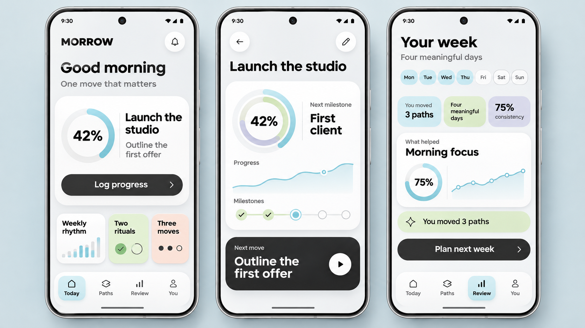

# Design direction

Last updated: 19 November 2026 (Asia/Kolkata)
Status: concept v2 approved as the visual foundation; production usability validation required

## Current candidate

Concept v2 is the approved visual foundation. It is not a pixel specification: layouts and components must change whenever real-device usability, accessibility, content density, or state coverage requires it. Concept v1 remains in the repository as evidence of an explicitly rejected palette, not as a source of approved tokens.

## What the references establish

Five user-supplied references were inspected as style and quality references. They are not licensed project assets and must not be copied, redistributed, or recreated literally.

Their shared grammar is:

1. **Cool luminous foundation.** Backgrounds are pale gray, blue-gray, or muted stone rather than pure white or warm cream.
2. **Sculpted modular surfaces.** Large white cards and circular wells feel machined or molded through subtle directional light, not glass blur.
3. **Strong sans-serif hierarchy.** Headlines and metrics are large, black, and direct. Secondary copy recedes through size and neutral tone rather than thin decorative typography.
4. **Instrument-like progress.** Rings, gauges, sliders, lines, and compact charts make progress feel tangible.
5. **Restrained pastel semantics.** Cyan, mint, peach, lavender, and occasional orange identify data or state; they do not flood the whole interface.
6. **Bento composition.** One dominant card is supported by smaller modules with deliberately different proportions.
7. **Circular chrome.** Back, edit, alert, play, and selection controls sit inside generous circular touch surfaces.
8. **Sparse navigation.** Most screens expose only a few high-confidence actions.
9. **Whitespace as hierarchy.** Separation comes from scale, grouping, and breathing room more than divider lines.
10. **Functional imagery only.** When imagery appears, it is integrated into a specific content module rather than used as general decoration.

## Interpretation for this product

The goal app should use the reference grammar to make long-term progress feel like a calm precision instrument. It must not look like a finance clone or fitness tracker.

The original product-specific visual idea is the relationship between:

- a large circular outcome instrument;
- a visible milestone rail;
- one high-contrast graphite next-move surface; and
- smaller weekly rhythm modules.

This makes the product's model—outcome, milestone, move, ritual—visually legible without explaining it in prose.

## Candidate tokens

These values are exploratory and require contrast testing in rendered Android screens before approval.

| Role | Candidate | Intended use |
| --- | --- | --- |
| Canvas | `#DCE5E8` | Presentation and optional large background areas |
| App surface | `#F7F8F7` | Primary screen surface |
| Raised surface | `#FFFFFF` | Cards and control wells |
| Graphite | `#111416` | Primary text and strongest action surface |
| Secondary text | `#5E6468` | Supporting labels when contrast passes |
| Glacier | `#B8DCE6` | Active/progress information |
| Mineral mint | `#CFE2C0` | Positive/steady state, never the sole indicator |
| Soft clay | `#E9BCAA` | Attention or planned work, not error |
| Periwinkle | `#C9C7E2` | Comparative/secondary data |
| Outline | TBD by tonal contrast tests | Surface boundaries and neutral controls |

Color rules:

- Graphite and white carry the brand; pastels carry meaning.
- Do not assign a different bright color to every goal.
- Never use color as the only state indicator.
- Red is reserved for destructive actions and genuine errors, not missed days or low progress.
- Support system dynamic color only as an explicit personalization mode; the branded default must remain coherent.

## Typography

- One variable grotesk sans family is preferred for brand, headings, metrics, body, and controls.
- Large metrics should use tabular figures when alignment matters.
- Use weight, size, and whitespace before introducing another typeface.
- Avoid the serif/sans split from concept v1.
- Final font selection must verify Android rendering, full language coverage, license, APK cost, and variable-font behavior.

## Shape and elevation

- Primary card radius target: 28–36dp on compact phones, adjusted by component size.
- Small modules: 20–28dp.
- Circular controls: minimum 48dp touch target even if the visible icon well is smaller.
- Navigation selection: raised or tonal well with both icon and label.
- Shadows are broad, low-opacity, and directional. They must not be the only boundary between surfaces.
- Tonal outlines or surface contrast must remain visible with shadows disabled and in high-contrast modes.

## Motion and haptics

- Use the Material expressive spring scheme for hero progress changes and milestone transitions.
- Use standard, quieter motion for data refresh, scrolling, dialogs, and routine navigation.
- A progress ring may settle with a slight spatial overshoot; chart lines must not bounce.
- Completion motion should show cause and effect, then yield to the next move.
- Reduced-motion mode replaces spatial transitions with short fades and value changes.
- Haptics confirm progress logging, milestone completion, and reorder boundaries; they must respect system settings.

## Accessibility guardrails

Soft UI becomes unusable when low contrast is treated as the style. Production screens must meet these minimums:

- Text contrast: at least 4.5:1 for normal text.
- Non-text/icon/surface contrast: at least 3:1 where the element conveys meaning or interaction.
- Body text: no smaller than 12sp; practical default should be larger.
- Interactive targets: at least 48dp.
- Every chart and progress instrument has a textual equivalent.
- Every state uses shape, label, icon, or weight in addition to color.
- TalkBack order and semantics follow the visual hierarchy.
- Dynamic type, display scaling, switch access, keyboard navigation where relevant, and reduced motion are design inputs, not post-build fixes.

## Do / avoid

Do:

- Make one card visually dominant per screen.
- Use circular progress only when a finite target exists.
- Keep navigation labels visible.
- Preserve generous margins at large font scales.
- Use explicit buttons for logging and planning.

Avoid:

- Copying the reference layouts, icons, people, financial data, or fitness content.
- Strict neumorphism with invisible boundaries.
- Glassmorphism, rainbow gradients, and decorative glow.
- Tiny gray copy, icon-only primary navigation, and gesture-only actions.
- Turning every screen into an analytics dashboard.
- Letting visual polish hide loading, empty, error, offline, and recovery states.

## Usability hierarchy

The interface is a tracking tool before it is a presentation surface. When visual drama and task completion conflict, task completion wins.

1. Goal names, current value, target, state, and next action must be scannable without opening each card.
2. The Goals destination always provides a true list view; bento modules are reserved for summaries and featured content.
3. Quick logging must be reachable from Today, each list row, and Goal detail.
4. The common log operation must take no more than two deliberate actions after the relevant goal is visible.
5. Charts supplement exact values and history; they never replace them.
6. Destructive and uncommon controls remain secondary but discoverable through labeled menus.
7. Users can undo a new log immediately and edit or delete historical entries through explicit actions.
8. Navigation, logging, filtering, sorting, and editing remain usable with large text and TalkBack.

Detailed flows and acceptance criteria are maintained in `docs/UX_REQUIREMENTS.md`.

## Research grounding

- [Android color guidance](https://developer.android.com/design/ui/mobile/guides/styles/color): tonal surfaces, semantic color, dynamic color, and accessibility.
- [Android accessibility foundations](https://developer.android.com/design/ui/mobile/guides/foundations/accessibility): text scaling, 4.5:1 text contrast, and 3:1 non-text contrast.
- [Material 3 modern UI](https://m3.material.io/get-started): expressive components, emphasized typography, expanded shape library, and adaptive foundations.
- [Material 3 motion](https://m3.material.io/styles/motion): expressive and standard physics schemes for different interaction types.
- [Official Android skills](https://github.com/android/skills): modular guidance for Compose, navigation, performance, security, testing, and Play workflows.

## Open questions

1. Should the cool blue-gray atmosphere remain fixed, or be tuned after the first real-device prototype?
2. Should the graphite next-move card be a signature element across all primary screens?
3. Should progress visualization favor rings, linear tracks, or a controlled mixture based on metric type?
4. Does the final brand want quiet precision, playful energy, or a balance weighted toward quiet precision?
